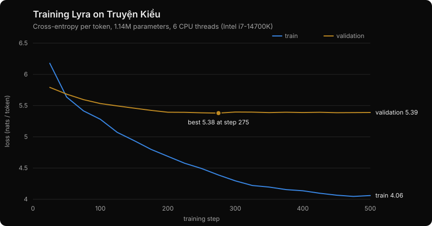

<p align="center"></p>

# Lyra Neural Verse

[](https://github.com/TIENDUNG21/lyra-neural-verse/actions/workflows/ci.yml)
[](LICENSE)

Lyra is a 1.1-million-parameter transformer, trained from scratch with its own NumPy
autograd on the 3,254 lines of Nguyễn Du's *Truyện Kiều*, that writes Vietnamese verse in
lục bát form. A constrained decoder masks the vocabulary at every step so that the tones
and rhymes of the form are always kept; the model only chooses among valid syllables.

```console
$ lyra sample --lines 4 --seed 1
Nỗi lòng nào thế người người
Thôi đà đã mấy người người mà chi
Đã đành chút phận hoa gì
Cũng là mình mới cũng khi chút này
-- seed 1: 0 rule violations, 3/3 exact rhymes, 0 relaxed lines

$ lyra sample --lines 4 --prompt "Trăm năm trong cõi người ta" --seed 4
Trăm năm trong cõi người ta
Tấm lòng nào có làm tơ cũng đành
Phải tin chàng mới gieo bình
Trăm trăm năm mới thưa minh bấy giờ
-- seed 4: 0 rule violations, 1/3 exact rhymes, 0 relaxed lines

$ lyra check "Trăm năm trong ngày người ta / Chữ tài chữ mệnh khéo lòng ghét nhau"
    1 [6] BBBBBB   trăm năm trong ngày người ta
    2 [8] TBTTTBTB chữ tài chữ mệnh khéo lòng ghét nhau
line 1, syllable 4: tone: 'ngày' (huyền) should be trắc
line 2, syllable 6: rhyme: 'lòng' does not rhyme with 'ta' (line 1, syllable 6)
2 lines, 2 violations, 0 waived; rhymes: 0 exact, 0 near
```

The verse above is model output, copied from a run of the committed model file. It sounds
like *Kiều* and keeps the form; it does not tell a story (see Limitations).

The same model file, engine and decoder run in the browser:
**[tiendung21.github.io/lyra-neural-verse](https://tiendung21.github.io/lyra-neural-verse/)**.
Nothing is sent to a server.

## The form

A lục bát poem alternates lines of six and eight syllables. Each syllable carries one of
six tones, grouped as bằng (ngang, huyền) and trắc (sắc, hỏi, ngã, nặng). Syllables 2, 4
and 6 of the six-line must be bằng, trắc, bằng; syllables 2, 4, 6 and 8 of the eight-line
bằng, trắc, bằng, bằng, with 6 and 8 split between ngang and huyền. Syllable 6 of the
six-line rhymes with syllable 6 of the eight-line, and syllable 8 of the eight-line with
syllable 6 of the next six-line. The checker enforces exactly these rules.

## How it works

**Text.** Input is normalized to NFC with zero-width characters removed, so NFD and NFC
text tokenize identically. An orthographic parser splits each syllable into onset,
medial, nucleus, coda and tone (`thuyền` = th + u + iê + n + huyền), handling `gi`/`qu`,
the diphthong spellings and the short ă hidden in `ay`/`au`. Rhymes are exact (same
nucleus and coda) or near (same coda, nucleus in the same front, back-rounded or central
class). Those classes were measured on the poem rather than assumed: of its 3,253 rhyme
pairs, 1,937 are exact, 1,289 near and 27 neither ([ADR 0003](docs/adr/0003-strict-rules-with-declared-exceptions.md)).

**Autograd and model.** `lyra.autograd.Tensor` records a define-by-run graph and
back-propagates with broadcasting-aware gradients. Softmax, layer norm, GELU,
cross-entropy and the embedding gather are fused kernels with hand-derived backward
passes, each checked against finite differences. `LyraLM` is a pre-norm GPT-style decoder
(Vaswani et al., 2017; Radford et al., 2019): 4 layers, 4 heads, width 128, context 128
tokens, tied input and output embeddings. Tokens are syllables, and each line starts with
an `<l6>` or `<l8>` marker.

Two embeddings add structure that the corpus is too small to teach. A syllable's vector is the
sum of its own vector and those of its onset, rhyme and tone, so rare syllables borrow
from syllables that sound alike, and the tied output layer can raise a whole rhyme class
at once. A line-slot embedding (line type plus position in the line, in the spirit of
SongNet's format embeddings, Li et al., 2020) tells the model which positions carry the
rules. The factored table is summed into a plain embedding at export, so the released
model is an ordinary transformer ([ADR 0004](docs/adr/0004-structure-aware-embeddings.md)).

**Decoding.** A state machine tracks the line type and position. Before sampling it masks
the logits: only the line marker at a line start, only bằng or only trắc at constrained
positions, the opposite of syllable 6's tone at syllable 8, and only rhyming syllables at
position 6. Temperature, top-k and top-p (Holtzman et al., 2020) then apply to what is
left. Generated poems therefore pass the checker by construction.

**Browser.** `lyra export` writes one 1.2 MB file: int8 matrices with a float32 scale per
output channel, float32 vectors, and a JSON header with the vocabulary. The TypeScript
port mirrors the Python engine, parser, checker and decoder. A fixture written by Python
(logits, five decoded poems, the parse of all 2,374 syllables, the checker's verdict on
the whole poem) is compared in CI; logits agree within 1e-3 and the decoded tokens are
identical, because sampling uses a mulberry32 generator and the same floating-point order
in both languages.

[docs/ARCHITECTURE.md](docs/ARCHITECTURE.md) walks through each module.

## Training and evaluation



The release run (`configs/kieu.json`) trains for 500 steps of 16 x 128 tokens with AdamW,
warmup and cosine decay, dropout 0.2 and 10% token dropout. It took 3.1 minutes on 6 CPU
threads of an Intel i7-14700K (32 GB RAM, Windows 11), about 5,600 tokens per second.
Every tenth block of 40 lines is held out (320 lines); the best checkpoint by validation
loss is step 275, after which the model starts to memorize.

Validation perplexity per syllable on the held-out lines, from `lyra evaluate` and
`scripts/summarize_runs.py`:

| Model | Syllable perplexity | All tokens | Best step |
|---|---|---|---|
| Unigram, add-0.5 smoothing | 1,082 | | |
| Bigram interpolated with unigram (weight tuned on training text) | 567 | | |
| Transformer, plain embeddings | 574 | 298 | 500 |
| + phonology embeddings | 671 | 424 | 225 |
| + line-slot embeddings | 476 | 221 | 500 |
| + both (release, int8 file) | **467** | **217** | 275 |

All four transformer rows use the same configuration and seed and differ only in the two
embedding switches (`configs/ablations/`). Line slots are the change that matters: without
them the model has to count syllables to find line ends and rhyme positions. Phonology
embeddings help only once slots are present; on their own they make the model memorize
sooner (best step 225). The two runs without phonology embeddings were still improving at
step 500, so a longer schedule could lower their numbers somewhat.

The int8 file loses nothing measurable (466.9 against 467.0 for the float32 checkpoint).

On the reference text itself, `lyra check` accepts all 3,254 lines with 60 declared
exceptions: 33 tone deviations in 29 six-syllable lines, all read with a 3/3 rhythm, and
27 forced rhymes. No eight-syllable line breaks the ngang/huyền contrast. The exceptions are
listed with reasons in `data/kieu-exceptions.tsv`, and a test fails if the strict
checker's findings stop matching that list.

`bash scripts/reproduce.sh` reruns the four trainings, the export, the plot, the
evaluation and the browser fixture.

## Usage

```sh
python -m pip install -e .
lyra sample --lines 8 --seed 3 --temperature 0.8
lyra sample --prompt "Trăm năm trong cõi người ta" --strict-rhyme
lyra check --file my-poem.txt
lyra train --config configs/kieu.json --out runs/my-run
lyra export --checkpoint runs/my-run/best.npz --tokenizer runs/my-run/tokenizer.json
lyra evaluate
```

`lyra check` exits with 0 when the poem is valid and 1 when it is not, so it can be used
in scripts. `--threads` (default 6) sets the BLAS thread count for training.

## Limitations

The corpus is one poem of 22,778 syllables. The model learns its vocabulary, its
collocations and its rhythm, not its narrative; lines are locally plausible and globally
aimless, and it repeats itself (`người người`). A validation perplexity of 467 over 2,378
syllable types is better than the n-gram baselines and still far from understanding.

The vocabulary is closed: 2,374 syllables, lowercased, built from the whole poem (the 61
held-out syllables never seen in training are still in it; ADR 0001). Names lose their
capitals, and the playground cannot write a syllable that *Kiều* does not contain.

Perplexity is measured on held-out passages of the same poem, not on other lục bát.

The checker covers canonical lục bát. It reports the 3/3-rhythm variant and forced rhymes
as violations (they are waived for *Kiều*, not accepted in general), it does not know
song thất lục bát, and its rhyme classes follow standard northern pronunciation.

Training is CPU-only and single-process, and generation in the browser runs on the main
thread, so the page is unresponsive while a poem is written.

## Building from source

Python 3.11 or newer (CI uses 3.13) with NumPy; Node 22 for the playground.

```sh
python -m pip install -e ".[dev]"
ruff check . && ruff format --check . && mypy && pytest

cd web
npm ci
npm run lint && npm run typecheck && npm test && npm run build
npm run dev   # http://localhost:5110/lyra-neural-verse/
```

The Python suite has 298 tests (gradient checks, Hypothesis properties for broadcasting,
normalization and sampling, the full-poem checker test, engine and decoder tests, an
end-to-end CLI run); the TypeScript suite has 21, including the parity tests.

## Roadmap

Not done, in rough order of value: train on more public-domain lục bát (*Lục Vân Tiên*,
*Hoa tiên*) to get past the one-poem ceiling; keep a display-casing table so names stay
capitalized; move browser generation into a Web Worker; support the song thất lục bát form
in the checker and decoder.

## Data and credits

*Truyện Kiều* (*Đoạn trường tân thanh*) by Nguyễn Du (1766-1820) is in the public domain.
The text comes from Vietnamese Wikisource, page "Truyện Kiều", revision 206607, fetched and
cleaned by `scripts/fetch_kieu.py`; Wikisource marks it `{{PD-old}}`, and Wikisource's
own contributions are available under CC BY-SA 4.0. Eight digitization errors are
corrected by line number, see [data/SOURCE.md](data/SOURCE.md).

## References

- Vaswani et al. 2017. Attention Is All You Need. NeurIPS.
- Radford et al. 2019. Language Models are Unsupervised Multitask Learners (GPT-2).
- Ba, Kiros and Hinton 2016. Layer Normalization. arXiv:1607.06450.
- Hendrycks and Gimpel 2016. Gaussian Error Linear Units (GELUs). arXiv:1606.08415.
- Press and Wolf 2017. Using the Output Embedding to Improve Language Models. EACL.
- Loshchilov and Hutter 2019. Decoupled Weight Decay Regularization (AdamW). ICLR.
- Loshchilov and Hutter 2017. SGDR: Stochastic Gradient Descent with Warm Restarts. ICLR.
- Srivastava et al. 2014. Dropout: A Simple Way to Prevent Neural Networks from Overfitting. JMLR.
- Bowman et al. 2016. Generating Sentences from a Continuous Space (word dropout). CoNLL.
- Holtzman et al. 2020. The Curious Case of Neural Text Degeneration (nucleus sampling). ICLR.
- Li et al. 2020. Rigid Formats Controlled Text Generation (SongNet). ACL.

## License

MIT, see [LICENSE](LICENSE).
